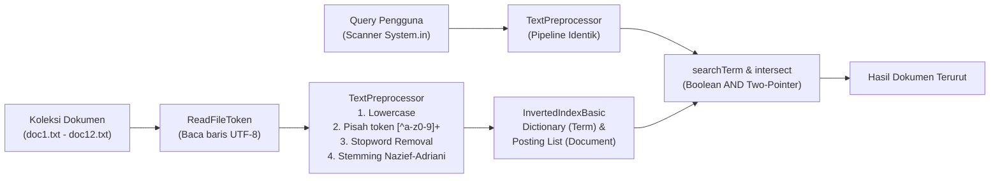

# Dokumentasi Teknis Project Inverted Index (UTS2-PI)

Dokumen ini menjelaskan secara rinci arsitektur sistem, alur pemrosesan data, alasan pemilihan metode dan algoritma pada setiap komponen, serta penjelasan sintaks Java yang digunakan agar mudah dipahami dan dikembangkan oleh pengembang lain.

---

## 1. Gambaran Umum & Arsitektur Sistem

Project **UTS2-PI** adalah implementasi **Inverted Index** berbasis **Java murni** (*pure Java*, tanpa dependensi library eksternal) untuk melakukan pengindeksan dan pencarian teks pada koleksi 12 dokumen berita berbahasa Indonesia (`doc1.txt` sampai `doc12.txt` di folder `UTS2-PI/Koleksi/`).

### Alur Kerja Sistem (Pipeline)



### Daftar Kelas dan Perannya

| Paket | Kelas | Tanggung Jawab Utama |
| :--- | :--- | :--- |
| `main` | `MainInvertedIndexBasic` | Titik masuk (`main`), memicu pengindeksan, mencetak isi index, dan menerima input query dari pengguna. |
| `test` | `ReadFileToken` | Membaca setiap file teks di direktori koleksi, mengirim tiap baris ke `TextPreprocessor`, lalu memasukkan token bersih ke `InvertedIndexBasic`. |
| `test` | `TextPreprocessor` | Menggabungkan seluruh tahap pra-pemrosesan teks (case-folding, pemisahan token, stopword removal, stemming) dalam satu pintu. |
| `test` | `Stopwords` | Menyimpan daftar kata umum (stopword) Bahasa Indonesia dalam `HashSet` read-only untuk penyaringan cepat. |
| `test` | `IndonesianStemmer` | Mengubah kata berimbuhan Bahasa Indonesia menjadi kata dasar menggunakan algoritma **Nazief–Adriani** + kamus kata dasar bawaan. |
| `test` | `InvertedIndexBasic` | Mengelola dictionary (`Term`), posting list (`Document`), serta menjalankan pencarian multi-kata (`searchTerm` + `intersect`). |
| `test` | `Term` | Menyimpan satu kata unik (`term`) beserta daftar dokumen kemunculannya (`documentList`). |
| `test` | `Document` | Menyimpan nama file dokumen dan mengimplementasikan `Comparable<Document>` untuk pengurutan alfabetis. |
| `test` | `LinkedListOrderedUnique<E>` | Struktur data turunan `LinkedList` yang otomatis menjaga elemen tetap **terurut menaik** dan **unik** (bebas duplikat). |

---

## 2. Alasan Pemilihan Struktur Data, Metode, dan Algoritma

### 2.1 Mengapa Menggunakan Inverted Index?

Jika pencarian dilakukan secara langsung dengan memindai seluruh isi dokumen setiap kali pengguna memasukkan kata kunci (*linear scan*), kompleksitasnya adalah $O(N \times M)$ (jumlah dokumen $\times$ panjang dokumen) untuk setiap query.

Dengan **Inverted Index**:
- Sistem membalik pemetaan dari *Dokumen $\to$ Kata* menjadi *Kata (Term) $\to$ Daftar Dokumen (Posting List)*.
- Contoh di output program: `mercon => doc1.txt doc10.txt doc2.txt doc3.txt doc4.txt`.
- Saat pencarian dilakukan, sistem cukup mencari term di dictionary lalu mengambil posting list-nya tanpa harus membaca ulang file `.txt` di disk.

---

### 2.2 Mengapa Menggunakan `LinkedListOrderedUnique`?

Kelas `LinkedListOrderedUnique<E>` mewarisi `java.util.LinkedList<E>` dan menambahkan dua method utama: `addSort(E)` dan `get(E)`.

**Alasan desain:**
1. **Keunikan otomatis**: Pada sebuah posting list, jika kata `"semarang"` muncul 10 kali di `doc1.txt`, `doc1.txt` hanya boleh tercatat **satu kali** pada posting list term `"semarang"`. Method `addSort` memeriksa `compareTo(e) == 0`; jika sama, penyisipan dilewati.
2. **Terurut otomatis (leksikografis)**: Ketika `compareTo(e) > 0`, elemen baru disisipkan tepat sebelum elemen tersebut menggunakan `iterator.previous()` + `iterator.add(e)`. Akibatnya:
   - Dictionary (`termList`) selalu tercetak rapi urut abjad (`00`, `000`, ..., `zigzag`).
   - Posting list (`documentList`) selalu terurut (`doc1.txt`, `doc10.txt`, `doc11.txt`, ..., `doc9.txt`), yang merupakan **syarat mutlak** agar algoritma *two-pointer intersection* dapat berjalan.

---

### 2.3 Mengapa Menggunakan *Two-Pointer Intersection* (`intersect`)?

Pada method `InvertedIndexBasic.searchTerm(String keywords)`, pencarian multi-kata menggunakan logika **Boolean AND** (dokumen harus mengandung *semua* kata kunci query).

**Cara kerja `intersect(p1, p2)`:**
Karena `p1` dan `p2` sama-sama sudah terurut menaik oleh `LinkedListOrderedUnique`, sistem tidak perlu melakukan nested loop $O(|p_1| \times |p_2|)$:
1. `iterator1` menunjuk ke elemen awal `p1` (`doc1`), `iterator2` menunjuk ke elemen awal `p2` (`doc2`).
2. Bandingkan `doc1.compareTo(doc2)`:
   - Jika `== 0` $\to$ dokumen ada di kedua list, tambahkan ke `answer`, lalu majukan **kedua** iterator.
   - Jika `< 0` $\to$ `doc1` tertinggal secara alfabetis, majukan `iterator1`.
   - Jika `> 0` $\to$ `doc2` tertinggal secara alfabetis, majukan `iterator2`.
3. Kompleksitas waktu menjadi linear **$O(|p_1| + |p_2|)$**, jauh lebih efisien daripada pencarian bersarang.

---

### 2.4 Mengapa Memilih Pemisahan Token (`[^a-z0-9]+` $\to$ Spasi)?

Sebelumnya, pembersihan karakter dilakukan dengan `replaceAll("[^a-z0-9]", "")` (menghapus simbol tanpa spasi). Pada koleksi berita Bahasa Indonesia, hal tersebut menimbulkan penggabungan kata yang tidak diinginkan, misalnya:
- `"jalan-jalan"` $\to$ `"jalanjalan"` (tidak cocok jika dicari dengan kata `"jalan"`)
- `"susul-menyusul"` $\to$ `"susulmenyusul"` (gagal di-stem menjadi `"susul"`)
- `"semarang-peserta"` (salah ketik di `doc2.txt`) $\to$ `"semarangpeserta"` (hilang dari posting list `"semarang"` maupun `"peserta"`)

Dengan mengubahnya menjadi:
```java
String normalized = text.toLowerCase().replaceAll("[^a-z0-9]+", " ").trim();
String[] rawTokens = normalized.split("\\s+");
```
Setiap karakter non-alfanumerik (`-`, `/`, `.`, `,`, tanda kutip, dll.) menjadi batas pemisah kata. Kata ulang dan gabungan tanda hubung terpecah menjadi token independen yang dapat disaring stopword dan di-stem dengan akurat.

---

### 2.5 Mengapa Menggunakan Stopword Removal Berbasis `HashSet`?

**Stopword** adalah kata-kata fungsi berfrekuensi sangat tinggi yang tidak membawa topik spesifik dokumen (misalnya `di`, `ke`, `dari`, `yang`, `dan`, `atau`, `adalah`, `akan`, `ini`, `itu`).

**Alasan teknis:**
1. **Memperkecil ukuran dictionary & mempercepat index**: Dari 1.489 token unik mentah pada koleksi, penyaringan stopword + stemming merampingkan dictionary menjadi **1.088 term unik**.
2. **Mengapa menggunakan `HashSet`?**
   - Pengecekan `STOPWORDS.contains(token)` pada `HashSet` memiliki kompleksitas waktu rata-rata **$O(1)$**, jauh lebih cepat dibanding mencocokkan elemen pada `Array`/`List` yang membutuhkan $O(n)$.
   - Dibungkus dengan `Collections.unmodifiableSet(...)` agar daftar bersifat *immutable* (aman dari perubahan tak sengaja).
3. **Kurasi daftar stopword yang tepat untuk korpus berita**:
   - Kata fungsi dan kata kutipan berita yang sangat umum (`kata`, `katanya`, `ujar`, `menurut`) ikut disaring.
   - Sebaliknya, kata konten penting seperti `tahun`, `baru`, `malam`, `hari`, `kota`, `jalan`, `warga`, `polisi` **sengaja dipertahankan** karena merupakan kata kunci pencarian yang valid pada berita perayaan tahun baru.

---

### 2.6 Mengapa Menggunakan Algoritma Stemming Nazief–Adriani (Java Murni)?

#### Mengapa tidak menggunakan Porter Stemmer atau pemotongan imbuhan sederhana?
- **Porter Stemmer** dirancang untuk morfologi Bahasa Inggris (hanya mengenal sufiks seperti `-ing`, `-ed`, `-ly`). Bahasa Indonesia memiliki struktur afiksasi yang jauh lebih kompleks: **prefiks** (`me-`, `pe-`, `ber-`, `ter-`, `di-`, `ke-`, `se-`), **sufiks** (`-kan`, `-i`, `-an`), **partikel/posesif** (`-lah`, `-kah`, `-nya`, `-ku`, `-mu`), serta **konfiks/imbuhan gabung** (`per-...-an`, `ke-...-an`, `me-...-kan`, `di-per-...-kan`).
- **Pemotongan naif tanpa kamus** sangat berbahaya bagi Bahasa Indonesia karena banyak kata dasar yang berawalan atau berakhiran mirip imbuhan (*over-stemming*). Contoh nyata dari koleksi project ini:
  - `semarang` $\to$ diawali `se-`, tanpa kamus akan salah dipotong menjadi `marang`.
  - `terompet` $\to$ diawali `ter-`, tanpa kamus akan salah dipotong menjadi `ompet`.
  - `beringin` $\to$ diawali `ber-`, tanpa kamus akan salah dipotong menjadi `ingin`.
  - `diponegoro`, `direktur`, `distributor` $\to$ diawali `di-`, tanpa kamus akan salah dipotong menjadi `ponegoro`, `rektur`, `stributor`.

#### Mengapa Nazief–Adriani (*Enhanced Confix Stripping*)?
Algoritma **Nazief–Adriani** menyelesaikan masalah morfologi Bahasa Indonesia secara sistematis melalui langkah-langkah berikut pada `IndonesianStemmer.java`:

1. **Pengecekan Kamus Kata Dasar (`ROOT_WORDS`)**:
   Jika kata sudah ada di `ROOT_WORDS`, proses langsung berhenti sehingga kata dasar seperti `semarang`, `terompet`, `beringin`, `mercon`, `kembang`, `petasan`, `halaman` tidak pernah rusak.
2. **Penghapusan Akhiran Infleksional (`stripInflectionalSuffixes`)**:
   Menghapus partikel (`-lah`, `-kah`, `-tah`, `-pun`) dan kata ganti milik (`-ku`, `-mu`, `-nya`) terlebih dahulu, misalnya `ditemukanlah` $\to$ `ditemukan`, `menyambutnya` $\to$ `menyambut`.
3. **Strategi Prioritas Awalan vs Konfiks (`stemCandidate`)**:
   - **Langkah A (hapus awalan saja terlebih dahulu)**: Menangani kata seperti `berjalan` $\to$ `jalan` atau `melawan` $\to$ `lawan` agar akhiran `-an` yang sebenarnya bagian dari kata dasar tidak ikut terpotong.
   - **Langkah B (hapus akhiran derivasional `-kan`/`-i`/`-an`, lalu awalan)**: Menangani kata berkonfiks seperti `perayaan` (`per-` + `raya` + `-an` $\to$ `raya`) atau `menyalakan` (`me-` + `nyala` + `-kan` $\to$ `nyala`).
4. **Aturan Kombinasi Awalan–Akhiran Terlarang (*Disallowed Affix Pairs*)**:
   Di `generatePrefixCandidates`, kombinasi yang tidak valid secara tata bahasa Indonesia langsung ditolak, antara lain:
   - `be-` tidak boleh berpasangan dengan `-i`
   - `di-`, `me-`, `te-` tidak boleh berpasangan dengan `-an`
   - `ke-`, `se-` tidak boleh berpasangan dengan `-i` atau `-kan`
   - `pe-` tidak boleh berpasangan dengan `-kan` (sehingga kata seperti `penumpukan` diproses sebagai `pen-` + `tumpuk` + `-an` $\to$ `tumpuk`, bukan `tumpu`).
5. **Aturan Peluluhan Konsonan (*Recoding*)**:
   Pada prefiks `meN-` dan `peN-`, huruf awal kata dasar `k, p, t, s` luluh ketika bertemu awalan. Stemmer mencoba varian tanpa recoding maupun dengan recoding:
   - `meng-` $\to$ `k` (`mengendarai` $\to$ `kendara`, `pengendara` $\to$ `kendara`)
   - `meny-` $\to$ `s` (`menyambut` $\to$ `sambut`, `penyambutan` $\to$ `sambut`, `menyemut` $\to$ `semut`)
   - `men-` $\to$ `t` (`menari` $\to$ `tari`, `penonton` $\to$ `tonton`, `menangkap` $\to$ `tangkap`)
   - `mem-` $\to$ `p` (`memakai` $\to$ `pakai`, `pemadam` $\to$ `padam`, `memadati` $\to$ `padat`)
6. **Penghapusan Awalan Berlapis hingga 3 Tingkat (`stripPrefixesWithDictRecursive`)**:
   Menangani kata dengan awalan bertingkat seperti `diperbolehkan` (`di-` + `per-` + `boleh` + `-kan` $\to$ `boleh`) atau `berkesudahan` (`ber-` + `ke-` + `sudah` + `-an` $\to$ `sudah`).
7. **Fallback Konservatif (`fallbackRuleBasedStem`)**:
   Jika kata belum terdaftar di `ROOT_WORDS` (misalnya kosakata baru saat pencarian), hanya imbuhan yang paling tidak ambigu (`meng-`, `meny-`, `men-`, `mem-`, `ber-`, `ter-`, `di-`, `-kan`) yang dipotong dengan syarat sisa kata minimal 3 huruf dan memiliki minimal 2 huruf vokal.

---

### 2.7 Mengapa Preprocessing Harus Simetris di Indexing dan Searching?

Salah satu kesalahan paling umum pada sistem *Information Retrieval* adalah hanya memasang *stopword removal* dan *stemming* di sisi pengindeksan (`ReadFileToken`), tetapi lupa memasangnya di sisi pencarian (`searchTerm`).

**Dampaknya jika tidak simetris:**
- Jika query `"perayaan di kota semarang"` tidak melalui `TextPreprocessor`:
  1. `"di"` dianggap kata kunci wajib; karena `"di"` sudah dibuang dari index saat indexing, pencarian mengembalikan **kosong**.
  2. `"perayaan"` tidak diubah menjadi `"raya"`, sehingga gagal cocok dengan entri `"raya"` di dictionary.

Dengan memusatkan seluruh logika pada `TextPreprocessor.preprocess(String)` yang dipanggil oleh **keduanya** (`ReadFileToken.readDocuments` dan `InvertedIndexBasic.searchTerm`), dokumen dan query selalu berada dalam ruang representasi term yang sama.

Selain itu, jika seluruh kata pada query pengguna berupa stopword (mis. `"di dan yang"`), `keywordList.isEmpty()` langsung mengembalikan hasil kosong secara aman tanpa error.

---

## 3. Penjelasan Sintaks & Konsep Java yang Digunakan

Bagian ini merangkum sintaks penting yang ada di kode sumber bagi pembaca yang ingin memahami detail bahasanya:

1. **`implements Comparable<T>` & `compareTo(T o)`** (`Document.java`, `Term.java`):
   Kontrak standar Java untuk menentukan urutan alami antar-objek. Mengembalikan `< 0` jika objek ini lebih kecil, `0` jika sama, dan `> 0` jika lebih besar. Dipakai oleh `LinkedListOrderedUnique` dan `intersect`.
2. **`ListIterator<E>`** (`LinkedListOrderedUnique.java`, `InvertedIndexBasic.java`):
   Iterator dua arah milik `LinkedList`. Berbeda dengan `Iterator` biasa, `ListIterator` memiliki method `previous()` dan `add(E)` sehingga `addSort` dapat mundur satu langkah lalu menyisipkan elemen di tengah list secara langsung.
3. **`static { ... }` (*Static Initializer Block*)** (`Stopwords.java`, `IndonesianStemmer.java`):
   Blok kode yang dieksekusi **hanya satu kali** oleh JVM saat kelas pertama kali dimuat ke memori. Cocok untuk mengisi `Set<String>` kamus kata dasar dan stopword agar tidak dibangun ulang setiap kali method `stem()` atau `isStopword()` dipanggil.
4. **`Collections.unmodifiableSet(words)`**:
   Membungkus `HashSet` menjadi himpunan *read-only* sehingga pemanggil method `getAll()` atau `getRootWords()` tidak bisa menambah/menghapus isi kamus secara tidak sengaja.
5. **Regex `[^a-z0-9]+` dan `\\s+`** (`TextPreprocessor.java`):
   - `[^a-z0-9]+`: mencocokkan satu atau lebih karakter yang **bukan** huruf kecil `a-z` maupun angka `0-9`.
   - `\\s+`: mencocokkan satu atau lebih karakter spasi/tab/newline untuk memecah kalimat menjadi array kata (`split`).
6. **`new Scanner(file, "UTF-8")`** (`ReadFileToken.java`):
   Membaca file teks dengan encoding UTF-8 secara eksplisit agar pembacaan karakter konsisten di berbagai sistem operasi (Windows/Linux) dan sesuai dengan konfigurasi `source.encoding=UTF-8` proyek.
7. **`private` Constructor pada Utility Class** (`Stopwords`, `IndonesianStemmer`, `TextPreprocessor`):
   Mencegah kelas utilitas yang hanya berisi method `static` diinstansiasi dengan `new ...()`.

---

## 4. Panduan Kompilasi & Pengujian

### Kompilasi & Eksekusi via Terminal (PowerShell)

```powershell
# 1. Kompilasi seluruh file sumber ke build\classes
javac -encoding UTF-8 --release 23 -d "UTS2-PI\UTS2-PI\build\classes" (Get-ChildItem "UTS2-PI\UTS2-PI\src\*.java" -Recurse | ForEach-Object { $_.FullName })

# 2. Jalankan program dari direktori proyek NetBeans agar path "..\Koleksi" valid
cd UTS2-PI\UTS2-PI
java -cp "build\classes" main.MainInvertedIndexBasic
```

### Contoh Kasus Uji

| Input Query | Token Setelah Preprocessing | Hasil Dokumen |
| :--- | :--- | :--- |
| `perayaan di kota semarang` | `["raya", "kota", "semarang"]` | `doc1.txt doc4.txt doc6.txt` |
| `jalan-jalan yang macet` | `["jalan", "jalan", "macet"]` | `doc1.txt doc9.txt` |
| `pengendara motor ditangkap polisi` | `["kendara", "motor", "tangkap", "polisi"]` | `doc2.txt` |
| `di dan yang` | `[]` *(semua tersaring stopword)* | `Keyword tidak ditemukan !` |
